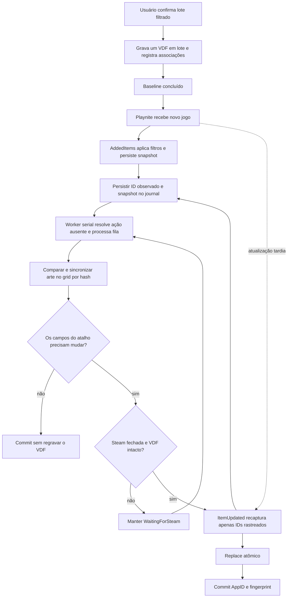

# Arquitetura da sincronização

**Estado validado em 28/10/2026:** o VDF contém 48 atalhos únicos; a fila da conta ativa registra 48 jogos `Synced`, as 48 operações de arte como `Committed` e 1.367 operações `FilteredOut`. Foram comparados por SHA-256 todos os 240 arquivos de arte da Steam com suas fontes atuais no Playnite; todos coincidiram. Os 48 campos de ícone do VDF apontam para os arquivos preparados, e nenhum caminho ou argumento de lançamento mudou. O Steam e o Playnite foram reabertos. O pacote local 0.9.3 foi recriado com a DLL validada; nenhum pacote ou release foi publicado.

## Componentes

| Componente | Responsabilidade |
|---|---|
| Plugin | Única classe concreta derivada de LibraryPlugin; encaminha as chamadas do host. |
| ShortcutsLibrary | Serviço interno com a lógica de biblioteca, exportação e estado do addon. |
| `AutoSyncHandler` | Captura eventos, aplica filtros, persiste snapshots, controla a sessão e agenda o worker serial; encaminha operações de SDK pela UI dispatcher. |
| `SyncQueueStore` | Journal JSONL, sequência monotônica, dedupe, coalescência, retry, manifesto e recuperação. |
| `ImportExportService` | Prepara atalhos diretos e encaminha ações dinâmicas de provedor pelo CLI oficial do Playnite; a exportação inicial é filtrada e grava um lote com confirmação. |
| `ShortcutsFile` | Parser binário VDF, ordem numérica dos índices, preservação dos campos desconhecidos e gravação validada com replace atômico. |
| `BackupManager` | Backup gerenciado verificado antes de uma alteração; bloqueia a escrita se o backup falha e impede replace quando o fingerprint muda durante a cópia. |
| `PluginSettingsView` | Fontes e filtros, estado agregado, retry e reconciliação manual. |
| `WriteBackHandler` | Atualiza apenas jogos do addon recebidos em eventos `ItemUpdated`; não varre a biblioteca inteira. |

## Fluxo normal

O primeiro export enumera a biblioteca uma vez para aplicar os filtros e montar o lote. Depois disso, o fluxo de adição não percorre a biblioteca. Uma enumeração integral filtrada ocorre ao ativar automação, mudar filtros/fontes, por reconciliação explícita ou recuperação após sessão não limpa/journal inválido. Abrir Playnite com uma sessão limpa não inicia varredura.

## Chaves e snapshot

- Associação: GUID `Game.Id`.
- Origem: GUID `Game.SourceId`; fontes distintas do mesmo `PluginId` são independentes. Steam e nomes começando com `Steam ` são excluídos.
- Destino: diretório de fila separado por SteamID64. Auto-detect resolve a conta única `MostRecent` do `loginusers.vdf`; sem marcador, só aceita um perfil inequívoco. A fila legada `default` migra para a conta detectada apenas se as operações não estiverem associadas a outro SteamID; uma incompatibilidade pausa o worker.
- Fingerprint: plugin de origem, nome, pasta de instalação, ROMs, tipo e campos da ação, instalação, estado oculto e referências de `Icon`, `CoverImage` e `BackgroundImage`.
- Payload: dados necessários para reconstruir ação `File`, `Emulator` ou `URL`, ID externo do jogo Playnite e `Game.Roms` (necessários para expandir variáveis como `{ImagePath}` depois de reiniciar), arte, conta e AppID conhecido. A preparação rejeita qualquer ação em que uma variável Playnite conhecida ainda permaneça sem expansão.

O evento de adição registra os IDs selecionados e persiste o snapshot antes do worker. Jogos Playnite sem `PluginId` só são elegíveis quando têm ação `Emulator` e esse filtro está ativo; nesse caso, o filtro de emulador é o opt-in porque não há fonte de biblioteca para selecionar. O estado persiste IDs recém-observados mesmo quando filtros como instalado/oculto os excluem temporariamente. `ItemUpdated` recaptura apenas IDs observados, enfileirados ou exportados, cobrindo metadados e ações que chegam depois da adição sem varrer a biblioteca.

Os snapshots incluem as referências de `Icon`, `CoverImage` e `BackgroundImage`. A mudança de referência altera o fingerprint; eventos `ItemUpdated` de jogos rastreados também carregam um token que força a checagem do conteúdo mesmo quando o caminho continua igual. Uma migração versionada faz uma passagem filtrada para verificar a arte já sincronizada; o marcador só é salvo depois que os snapshots foram gravados na fila. Chamadas concorrentes de atualização da biblioteca são coalescidas. O marcador versionado permanece depois que os snapshots são persistidos; uma inicialização limpa dedicada para conferir que a migração concluída não se repete ainda está pendente.

No worker, cada imagem é comparada por SHA-256 com o destino no grid. Conteúdo idêntico não é regravado. Conteúdo diferente é copiado para um temporário, verificado contra a fonte e instalado por replace atômico; a versão anterior é preservada em backup gerenciado com hash antes de ser substituída. A capa vai para `AppID` e `AppIDp`, o ícone para `AppID_icon` e `AppID_logo`, e o fundo para `AppID_hero`. Falha ao localizar ou copiar uma imagem mantém a operação em retentativa. Uma extensão antiga do mesmo slot só é removida após a nova cópia ser validada. Remover uma imagem do Playnite não apaga automaticamente a cópia do grid.

A cópia de arte pode ocorrer com o Steam aberto. O worker só espera `Steam.exe` fechar quando precisa alterar `shortcuts.vdf`; atalhos sem diferença não causam backup nem replace do VDF. A escrita inclui backup verificado, verificação de fingerprint concorrente e replace atômico. Depois de sincronizar os arquivos, o Steam foi fechado para aplicar os caminhos de ícone e reaberto. Nesta validação, as operações também acrescentaram as tags atuais do Playnite; executável, diretório de trabalho e argumentos permaneceram iguais.

Quando não há `GameAction` persistida, o callback não chama plugins nem varre diretórios. No worker, pela UI dispatcher, o addon consulta os plugins carregados. Se existir exatamente um `PlayController` dinâmico e nenhum `Play` persistido, cria um atalho para `Playnite.DesktopApp.exe --start <Game.Id> --actionindex 0 --nolibupdate`; o próprio provedor continua responsável por iniciar o jogo. Se não houver essa rota, o worker procura um executável até profundidade dois e aceita apenas candidato único ou correspondência clara por nome. A busca sem resultado ou ambígua vira `NeedsAttention`. Mais de um controlador dinâmico também exige atenção para não iniciar a opção errada.

Operações que consultam o SDK — captura de dados, reconciliação, enumeração de controladores, resolução de emuladores e persistência de configurações — passam pela UI dispatcher. Leitura, descoberta de executável, backup e substituição do VDF ocorrem no worker; o primeiro baseline faz a pré-resolução antes da confirmação para informar a quantidade.

## Arquivos locais

Em `ExtensionsDataPath/<plugin>/automatic-sync/<steam-user>/`:

- `sync-journal.jsonl`: operações com sequência monotônica e payload mínimo.
- `sync-state.json`: estado atual, baseline, sessão, operações e GUID → AppID.
- `sync-state.json.bak`: checkpoint anterior após substituição atômica.
- `sync-journal.jsonl.bak`: cópia criada durante compactação do journal.

O journal é a origem das operações pendentes; o manifesto é o checkpoint. Ao carregar, entradas válidas são recuperadas mesmo se o checkpoint estiver desatualizado. Linha malformada é descartada, journal reescrito e uma reconciliação de recuperação é solicitada. A compactação descarta histórico terminal redundante, mas conserva a operação `FilteredOut` mais recente de cada jogo para que atualizações idênticas continuem deduplicadas após reinício. Payload contém nomes e caminhos locais, sem credenciais de loja.

## Estados e recuperação

`Pending → Prepared → Committed`; Steam ativa antes de uma alteração de VDF produz `WaitingForSteam`; falha temporária produz `RetryableFailure`; ação/VDF ambíguo produz `NeedsAttention`; filtro atual produz `FilteredOut` até uma mudança elegível. Snapshots mais novos supersedem antigos, mesmo quando o antigo está em backoff. O worker prioriza operações novas antes de retentativas em espera para que uma fila de jogos aguardando o Steam fechar não bloqueie outras operações.

Antes de gravar VDF, persistir AppID e payload preparados. Se o processo cair depois do replace e antes do commit, o replay procura o mesmo AppID e atualiza a mesma entrada. A gravação compara um hash do VDF lido com o arquivo atual antes do replace para não sobrescrever alteração concorrente.

A sessão só recebe `SessionClean=true` quando não há captura de evento, worker, retry, reconciliação ou recuperação pendente. Se um callback for interrompido pelo encerramento, a próxima abertura solicita reconciliação. Cada worker conserva a referência ao store da conta que criou a operação e valida a conta selecionada antes de gravar; uma troca de conta deixa a operação durável no store original.

Ao ativar automação depois do baseline, uma reconciliação filtrada cobre a janela em que a captura de eventos estava desligada. Mudanças de fontes/filtros também reconciliam o estado atual. Pedidos concorrentes são coalescidos em uma passagem subsequente.

## Limites técnicos

- Steam pode iniciar entre a checagem final e o replace; duas verificações e replace atômico reduzem, mas não eliminam essa corrida.
- A rota Auto-detect e a migração da fila legada têm cobertura automatizada e foram verificadas no perfil ativo após reiniciar o Playnite. Encerramentos não limpos acionam recuperação da fila. Uma reabertura limpa não deve iniciar reconciliação completa; ainda falta um ensaio dedicado para confirmar esse comportamento após a migração de arte, além de estabilidade prolongada e reinicialização do Windows.
- Os arquivos de arte e os ícones do VDF foram validados por hash e parse; uma inspeção visual prolongada do Big Picture ainda é necessária para avaliar cache de interface.
- A rota por CLI depende de Playnite continuar instalado no mesmo caminho e de estar aberto ou conseguir iniciar; ações dinâmicas múltiplas permanecem manuais. A fila automática foi exercitada com um evento AddedItems sintético; ainda falta um evento originado por importação real de provedor.
- A UI dispatcher reduz acessos fora da thread do Playnite; falta observar callbacks de background e a responsividade durante uma execução prolongada.
- Não há sync enquanto Playnite está fechado; um watcher do banco privado criaria risco de concorrência e corrupção.
